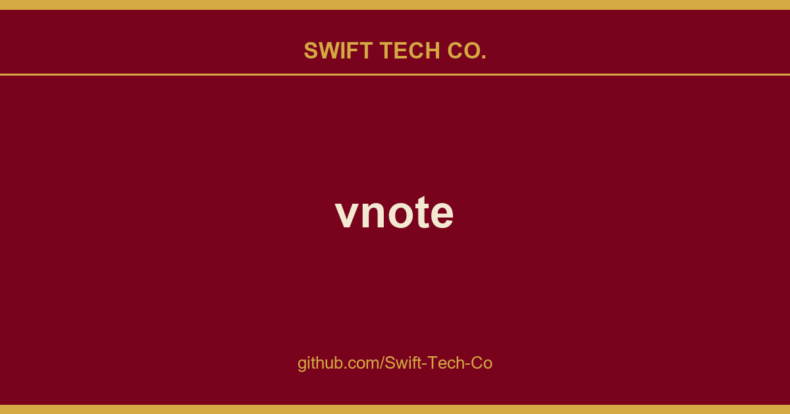

# vnote

## What This Is

This is part of the Swift Tech Co. working stack for product and engineering. It gathers the vnote notes, examples and fixes that keep delivery fast, and doubles as the reference map we hand to whoever picks up this thread next.

## Images

[](https://github.com/Swift-Tech-Co/vnote)

## Description
**VNote** is a Qt-based, free and open source note-taking application, focusing on Markdown now. VNote is designed to provide a pleasant note-taking platform with excellent editing experience.

VNote is **NOT** just a simple editor for Markdown. By providing notes management, VNote makes taking notes in Markdown simpler. In the future, VNote will support more formats besides Markdown.

Utilizing Qt, VNote could run on **Linux**, **Windows**, and **macOS**.

[](https://github.com/Swift-Tech-Co/vnote)

## Downloads
Continuous builds on `master` branch could be found at the Continuous Build release.

Latest stable builds could be found at the latest release or Gitee release

## Supports
* GitHub Issues;
* Email: `tamlokx at gmail.com`;

## Development

After cloning the repository, run the initialization script to set up your development environment:

**Linux/macOS:**
```bash
bash scripts/init.sh
```

**Windows:**
```cmd
scripts\init.cmd
```

This script will:
* Initialize and update all git submodules
* Install pre-commit hooks for automatic code formatting with clang-format
* Set up the vtextedit submodule pre-commit hook

For more development guidelines, see [AGENTS.md](AGENTS.md).

## License
VNote is licensed under GNU LGPLv3.

Bundled third-party material and the notices its licenses require  the Lucide
(ISC/MIT) and IconPark (Apache-2.0) icon sets  are recorded in
[THIRD-PARTY-NOTICES.md](THIRD-PARTY-NOTICES.md).

---

## Swift Tech Co.

Built and maintained by Swift Tech Co.

AI Automation | FinTech Platforms | Custom Software and Mobile Apps | SaaS Platforms | Cloud Infrastructure | Cybersecurity | SEO and Marketing | API Integration

**Join our community on Telegram:** [t.me/+Qt_eFvkb2rliMzNh](https://t.me/+Qt_eFvkb2rliMzNh)

Home | Services | Careers | Referral Program | Influencers | About | Contact

**Connect**

- Website: https://github.com/Swift-Tech-Co/vnote
- LinkedIn: [linkedin.com/in/stephenoladoke](https://www.linkedin.com/in/stephenoladoke/)
- LinkedIn (Company): [linkedin.com/company/swift-tech-co](https://www.linkedin.com/company/swift-tech-co)
- X: [@MrOladoke](https://x.com/MrOladoke)
- Instagram: [@mr.oladoke](https://www.instagram.com/mr.oladoke/)
- Organization: [github.com/Swift-Tech-Co](https://github.com/Swift-Tech-Co)

## Sources

Compiled and maintained from upstream [vnotex/vnote](https://github.com/vnotex/vnote) under permissive open-source license.

---

Maintained by [Swift Tech Co.](https://github.com/Swift-Tech-Co) - [Telegram](https://t.me/+Qt_eFvkb2rliMzNh)

## Sources

Compiled and maintained from upstream [vnotex/vnote](https://github.com/vnotex/vnote) under permissive open-source license.

---

Maintained by [Swift Tech Co.](https://github.com/Swift-Tech-Co) - [Telegram](https://t.me/+Qt_eFvkb2rliMzNh)

## Sources

Compiled and maintained from upstream [vnotex/vnote](https://github.com/vnotex/vnote) under permissive open-source license.

---

Maintained by [Swift Tech Co.](https://github.com/Swift-Tech-Co) - [Telegram](https://t.me/+Qt_eFvkb2rliMzNh)

## Sources

Compiled and maintained from upstream [vnotex/vnote](https://github.com/vnotex/vnote) under permissive open-source license.

---

Maintained by [Swift Tech Co.](https://github.com/Swift-Tech-Co) - [Telegram](https://t.me/+Qt_eFvkb2rliMzNh)